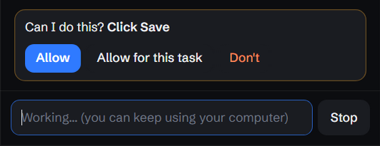

# Desktop Buddy

Shows you where to click, in any Windows app, with the AI you choose.

Ask Buddy how to do something in the app in front of you. Its blue pointer flies to the button you need and says
what to do, one step at a time, while you do the clicking. It does things for you only when you ask, and asks before
each one unless you tell it otherwise.

<!-- OWNER: record a 30-second guided Excel task, save it as docs/media/buddy-demo.mp4 and docs/media/buddy-demo.gif
     (see "Owner handover" in docs/DEVELOPING.md), then remove the two comment markers around the next line. -->
<!-- 

 -->

  <a href="https://github.com/donlapidos/desktop-buddy/releases/latest"><b>Download Desktop Buddy for Windows</b></a>
  · free and open source

| Buddy points and tells you what to do | Buddy asks before it does anything | Mark anything and ask about it |
|---|---|---|
| <!-- OWNER: docs/media/pointer.png --> *Picture coming soon* |  | <!-- OWNER: docs/media/mark.png --> *Picture coming soon* |

## Three ways to start

Buddy needs an AI to think with. The first time it starts, it offers three ways in:

1. **With the AI app you already use.** Claude Code, the Claude app, Codex, Gemini CLI, Cursor, VS Code (Copilot),
   Windsurf or LM Studio. Buddy adds itself in one click; no key needed.
2. **With a key from an AI company.** Paste a key from Anthropic (Claude), OpenAI (GPT), OpenRouter, Google Gemini or
   DeepSeek (for DeepSeek, choose it in Settings first). You can set a monthly spending limit.
3. **With a free model on your own PC.** Run Ollama or LM Studio with a model that can use tools (it needs about
   8 GB of free memory). Nothing leaves your PC.

### How models do with Buddy

Measured with Buddy's own checks (`npm run eval`). Settings marks a model "works well" from 90% of tasks passed,
here or in your own "Check this model" run.

| Model | Tasks passed | Seconds a task | Cost a task | Checked |
|---|---|---|---|---|
| OpenAI gpt-6.1-sol | 6 of 6 (workflows) | 4.4 | not priced yet | 2026-11-16 |

More models (Claude, Gemini's free tier, a model on your PC) are being checked.

## What you can do

- **Ask:** press **Ctrl+Alt+B** in any app, or hover the island at the top of your screen. Buddy reads the window,
  points at what you need and labels it. If you work ahead, it follows.
- **Talk:** hold **Ctrl+Alt+B**, say what you need, and let go. Buddy answers out loud. Listening and speaking run on your PC.
- **Mark:** press **Ctrl+Alt+M** and draw around anything on your screen, then ask about it ("what does 1 do?").
- **Explain:** hover over anything and press **Ctrl+Alt+E** for an illustrated one-page explanation.
- **Do it for me:** say "do it for me" and Buddy works the app itself, asking before each click, keystroke or file
  change. **Settings › Activity** lists what it changed and can undo it.

Everything else (dictation, task windows, routines, Word documents, settings) is in the [guide](docs/GUIDE.md).

## Install

Run `Desktop-Buddy-Setup-<version>.exe` from the [latest release](https://github.com/donlapidos/desktop-buddy/releases/latest).
It installs for your Windows account only (no administrator prompt) and keeps itself up to date. If Windows
SmartScreen says it "protected your PC", choose **More info › Run anyway**. More in the
[guide](docs/GUIDE.md#install).

## Your privacy

- Buddy has no server and no account of its own.
- With a key, your question and the window you ask about (text, and a picture when the model can see) go to the AI
  company you chose, under your account. With a model on your PC, nothing leaves the PC.
- Voice runs on your PC. Keys are stored encrypted by Windows and only sent to their own provider.
- Window pictures can be turned off in **Settings › AI & privacy**.

The full details are in [AI and privacy](docs/GUIDE.md#ai-and-privacy).

## More

- [Using Desktop Buddy](docs/GUIDE.md): every feature and setting.
- [Developing Desktop Buddy](docs/DEVELOPING.md): run from source, tests, configuration, how it fits together,
  releasing.
- [What's new](CHANGELOG.md) · [What's next](ROADMAP.md) · [Design](DESIGN.md)
- **Buddy Plus** (an idea): the AI included for one monthly price.
  [Say if you'd want it](https://github.com/donlapidos/desktop-buddy/issues/new?template=buddy-plus.yml).

Built on [agent-desktop](https://github.com/vercel-labs/agent-desktop). Apache-2.0 licence; third-party licences
are in [THIRD_PARTY_NOTICES.md](THIRD_PARTY_NOTICES.md).
